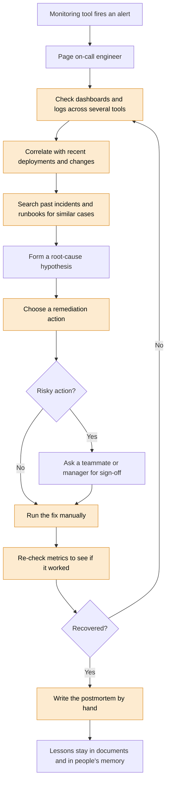
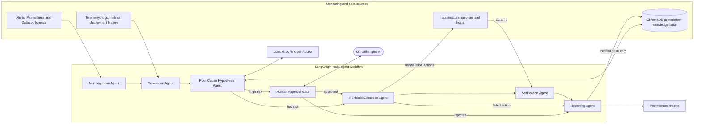
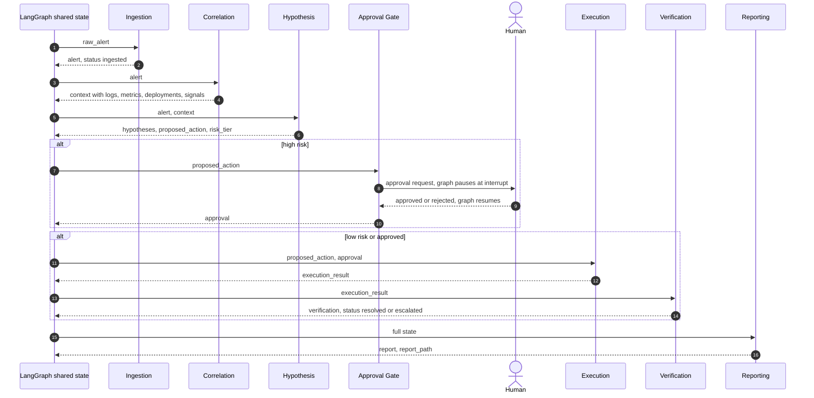
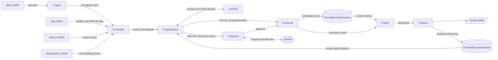
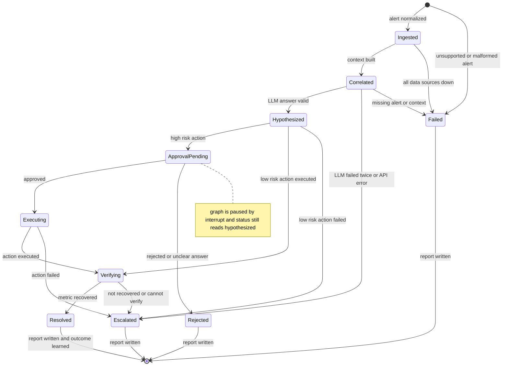
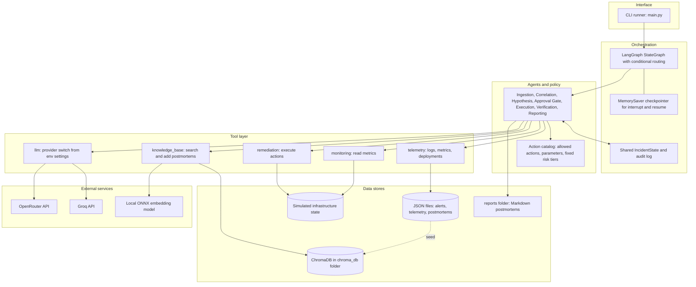
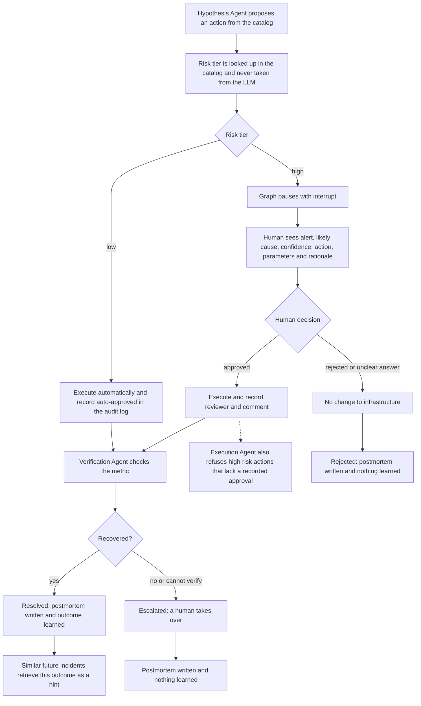

# OpsSentinel Architecture

Seven views of the system. The diagrams match the code in `src/opssentinel/`.

## 1. Existing process workflow (human on-call)

Highlighted steps are the repetitive work the system takes over.

## 2. Proposed multi-agent architecture

Ingestion, correlation and hypothesis failures also route to the Reporting Agent, so every incident ends with a report.

## 3. Agent communication flow

Agents never talk to each other directly. Each reads a shared, typed state and returns a partial update; LangGraph decides which node runs next.

## 4. Data flow

Every step also appends a timestamped entry to the audit log in the shared state; the Reporting Agent turns that log into the report timeline.

## 5. State diagram

The `status` field of the incident state. The approval pause is an interrupt in the graph, not a status value.

## 6. System architecture

## 7. Human-in-the-loop workflow

